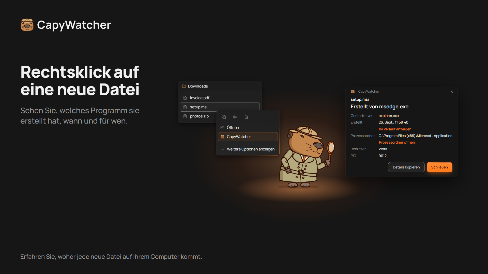
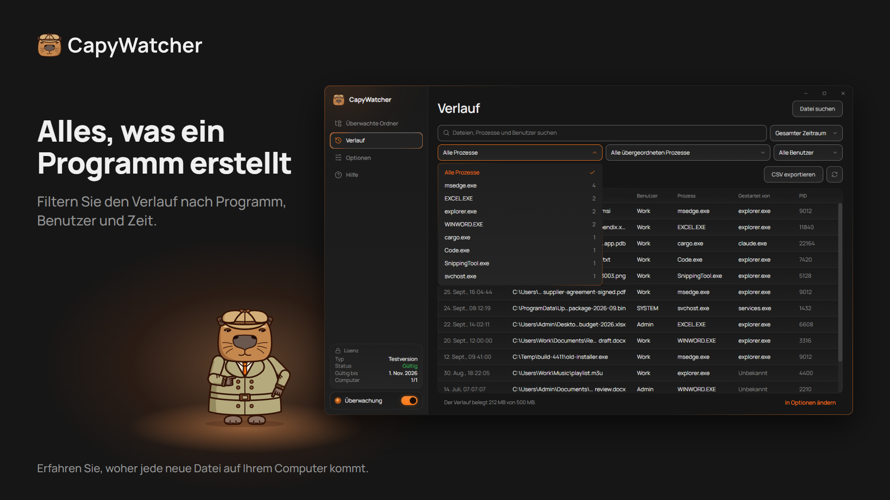

  

# CapyWatcher: Wer hat diese Datei erstellt?

**Ein Rechtsklick auf eine neue Datei in Windows zeigt, welches Programm sie erstellt hat und welcher KI-Agent dieses Programm gestartet hat.**

[Kostenlose Testversion herunterladen](https://capywatcher.com/de/download) · [Preise ansehen](https://capywatcher.com/de/pricing) · [Versionshinweise lesen](https://capywatcher.com/de/release-notes)

Windows 11 oder Windows 10 Version 1803 oder neuer, 64-Bit (x64). 7 Tage kostenlos, ohne Karte und ohne E-Mail.

[English](README.md) · Deutsch · [Español](README.es.md) · [Français](README.fr.md) · [Italiano](README.it.md) · [Polski](README.pl.md) · [Português (Brasil)](README.pt-BR.md) · [日本語](README.ja.md)

## Wofür es da ist

Windows merkt sich nicht, welches Programm eine Datei erstellt hat, und die meisten Tools sehen nur, was passiert, während man ihnen zusieht. CapyWatcher läuft im Hintergrund und zeichnet jede neue Datei in den Ordnern Ihrer Wahl auf: das Programm, das sie erstellt hat, das Programm, das dieses gestartet hat, den Benutzer und die Uhrzeit. Wenn eine Datei auftaucht und Sie sich fragen, woher sie kommt, ist die Antwort schon da.

Gemacht für alle, die KI-Agenten zum Programmieren wie Claude Code, Codex oder Cursor nutzen, für Windows-Power-User mit rätselhaften Dateien und für alle, die wissen wollen, welcher Installer, welches Spiel, welcher Download oder welches Skript eine Datei auf ihren Computer gelegt hat.

## Funktionen

### Die Antwort per Rechtsklick

Klicken Sie im Datei-Explorer mit der rechten Maustaste auf eine Datei (unter Windows 11 unter Weitere Optionen anzeigen) und wählen Sie CapyWatcher. Ein kleines Fenster zeigt, welches Programm sie erstellt hat, wann, für welchen Benutzer und die Kette der Programme, die es gestartet haben. Sie können eine Datei auch in der App suchen oder Dateien und Ordner auf ihr Fenster ziehen.

### Verlauf nach Programm

Beginnen Sie bei einem Programm und sehen Sie jede Datei, die es erstellt hat. Durchsuchen Sie Dateipfade, Programme und Benutzer, und filtern Sie nach Programm, übergeordnetem Prozess, Benutzer und Zeitraum, jeweils mit Anzahl. Blenden Sie einen Prozess aus, der den ganzen Tag Dateien erstellt (mit Rückgängig), und speichern Sie die gefilterten Zeilen als CSV-Datei.

### Was Ihr KI-Agent geschrieben hat

Eine Datei, die `cargo.exe` oder `node.exe` geschrieben hat, nennt auch das Programm, das es gestartet hat, zum Beispiel `claude.exe`. So sehen Sie, was Ihr KI-Agent geschrieben hat und wo. Wie `git blame`, für neue Dateien.

### Mehrere Dateien und Umbenennungen

Markieren Sie mehrere Dateien, klicken Sie mit der rechten Maustaste und sehen Sie das Programm jeder Datei. Ein Download, der am Ende umbenannt wird, nennt weiter den Browser, der ihn gespeichert hat.

### Nur die Ordner Ihrer Wahl

Wählen Sie die Ordner aus, die überwacht werden, auf jedem Laufwerk in Ihrem Computer. Ein nicht verbundenes Laufwerk behält seine Einstellung, bis es wieder da ist.

### Ein Verlauf unter Ihrer Kontrolle

Legen Sie fest, wie lange der Verlauf aufbewahrt wird, wie groß er werden darf, was am Limit passiert und in welchem Ordner er liegt. Löschen Sie ihn ganz, wann immer Sie wollen.

### Leise im Infobereich

Die App startet mit Windows im Infobereich neben der Uhr. Benachrichtigungen von Windows melden sich, wenn ein Update bereitsteht und wenn der Verlauf fast voll ist, und neue Versionen können sich selbst installieren.

### Für Ihre Arbeitsweise

Helles und dunkles Design und Windows-Kontrastdesigns. Jede Ansicht lässt sich ganz mit der Tastatur und mit einem Bildschirmleser bedienen und folgt der Windows-Einstellung Textgröße bis 225 %. Speichern Sie Ihre Einstellungen in einer Datei und laden Sie sie auf einem anderen Computer.

### Leicht für Ihren Computer

Der Hintergrunddienst braucht unter 20 MB Arbeitsspeicher und weniger als 1 % CPU, während er neue Dateien aufzeichnet.

### In 8 Sprachen

Englisch, Deutsch, Spanisch, Französisch, Italienisch, Polnisch, Portugiesisch (Brasilien) und Japanisch. Die App nutzt Ihre Windows-Sprache, wenn sie sie hat.

## Datenschutz

Der Verlauf bleibt auf Ihrem Computer, und der Dienst, der Ihre Ordner überwacht, hat keinen Netzwerkzugriff. Kein Konto, keine Nutzungsstatistiken. Zwei Prüfungen gehen online, an den Server der App: die Lizenzprüfung und die Suche nach Updates. Sie senden nie Ihre Dateien, Ihren Verlauf oder den Namen Ihres Computers.

[Datenschutzerklärung lesen](https://capywatcher.com/de/privacy)

## Ehrliche Grenzen

- CapyWatcher zeichnet neue Dateien ab der Installation auf und kann deshalb nichts über ältere sagen.
- Es zeichnet Dateien auf, die in überwachten Ordnern erstellt oder umbenannt werden, keine Löschungen oder Änderungen.
- Es funktioniert nicht auf Netzlaufwerken, nur auf Laufwerken in Ihrem Computer.
- Es zeichnet auf, welches Programm eine Datei erstellt hat. Es blockiert nichts.

## Preis

Testen Sie 7 Tage lang jede Funktion kostenlos, ohne Karte und ohne E-Mail. Danach 29 $ pro Jahr bis zur Kündigung oder 49 $ einmalig. Jede Lizenz gilt für bis zu 3 Computer.

Die Preise sind in US-Dollar. Je nach Wohnort kann beim Bezahlen Steuer hinzukommen.

[Preise ansehen](https://capywatcher.com/de/pricing)

## Über dieses Repository

CapyWatcher ist nicht quelloffen. Dieses Repository enthält deshalb seine Produktseite, nicht seinen Code. Laden Sie die App auf [capywatcher.com](https://capywatcher.com/de/download) herunter.

## Hilfe und Neuigkeiten

- E-Mail: [support@capywatcher.com](mailto:support@capywatcher.com)
- X: [@CapyWatcherApp](https://x.com/CapyWatcherApp), für Neuigkeiten und Direktnachrichten
- Versionshinweise: [capywatcher.com/de/release-notes](https://capywatcher.com/de/release-notes), mit einem [RSS-Feed](https://capywatcher.com/de/release-notes/rss.xml)

## Gemacht von Admiral Capy

[@AdmiralCapy auf X folgen](https://x.com/AdmiralCapy) · [Mehr über den Macher lesen](https://capywatcher.com/de/about)
