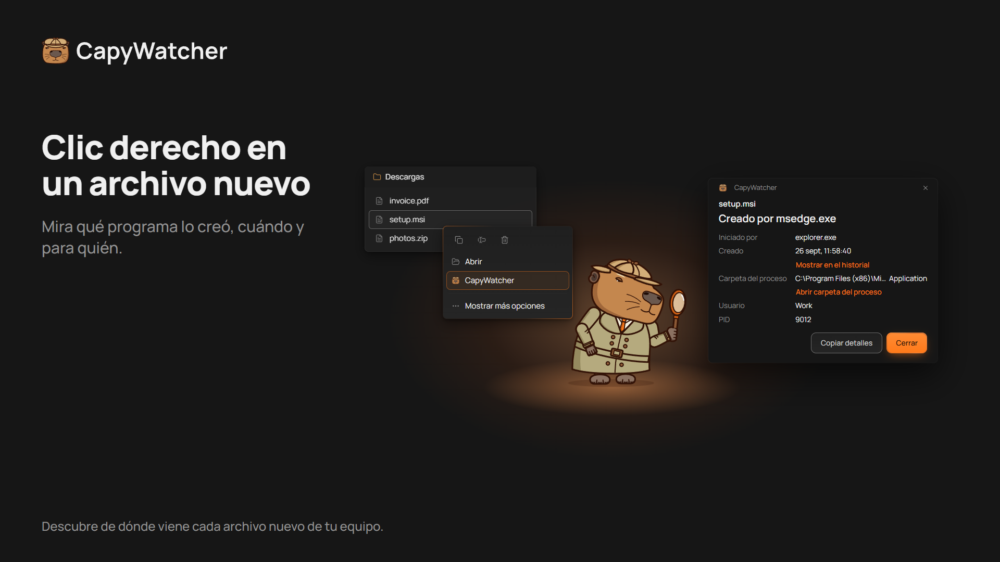
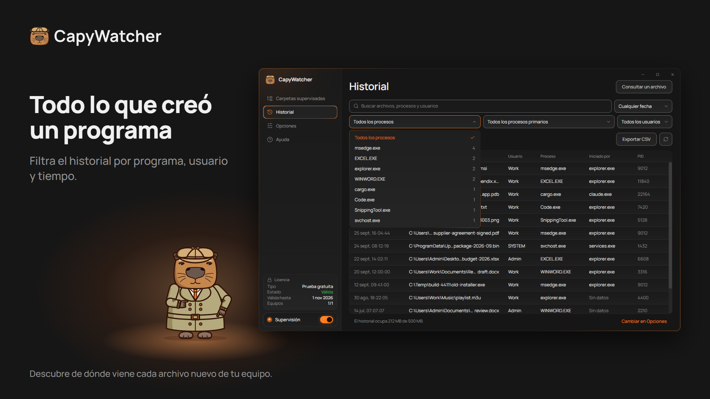

  <picture>
    <source media="(prefers-color-scheme: dark)" srcset="https://raw.githubusercontent.com/capywatcher/capywatcher/main/images/logo-dark.png">
    <source media="(prefers-color-scheme: light)" srcset="https://raw.githubusercontent.com/capywatcher/capywatcher/main/images/logo-light.png">
    
  </picture>

  <h1>CapyWatcher: ¿quién creó este archivo?</h1>

  
<strong>Haz clic derecho en un archivo nuevo de Windows y mira qué programa lo creó, y qué agente de IA inició ese programa.</strong>

  
<a href="https://capywatcher.com/es/download">Descargar la prueba gratuita</a> &nbsp;·&nbsp; <a href="https://capywatcher.com/es/pricing">Ver precios</a> &nbsp;·&nbsp; <a href="https://capywatcher.com/es/release-notes">Leer las notas de la versión</a>

  
Windows 11, o Windows 10 versión 1803 o posterior, de 64 bits (x64). Gratis durante 7 días, sin tarjeta y sin correo.

  

    
    &nbsp;
    
    &nbsp;
    
  

  
<a href="README.md">English</a> &nbsp;·&nbsp; <a href="README.de.md">Deutsch</a> &nbsp;·&nbsp; Español &nbsp;·&nbsp; <a href="README.fr.md">Français</a> &nbsp;·&nbsp; <a href="README.it.md">Italiano</a> &nbsp;·&nbsp; <a href="README.pl.md">Polski</a> &nbsp;·&nbsp; <a href="README.pt-BR.md">Português (Brasil)</a> &nbsp;·&nbsp; <a href="README.ja.md">日本語</a>

## Para qué sirve

Windows no guarda qué programa creó un archivo, y la mayoría de las herramientas solo ven lo que pasa mientras las miras. CapyWatcher funciona en segundo plano y registra cada archivo nuevo en las carpetas que elijas: el programa que lo creó, el programa que inició a ese, el usuario y la hora. Cuando aparece un archivo y te preguntas de dónde salió, la respuesta ya está ahí.

Está pensado para quienes usan agentes de IA de programación como Claude Code, Codex o Cursor, para usuarios avanzados de Windows con archivos misteriosos, y para cualquiera que quiera saber qué instalador, juego, descarga o script dejó un archivo en su equipo.

## Funciones

### La respuesta con clic derecho

Haz clic derecho en un archivo en el Explorador de archivos (en Windows 11, en Mostrar más opciones) y selecciona CapyWatcher. Una ventana pequeña muestra qué programa lo creó, cuándo, para qué usuario, y la cadena de programas que lo iniciaron. También puedes consultar un archivo desde la app, o soltar archivos y carpetas en su ventana.

### El historial por programa

Empieza por un programa y mira cada archivo que creó. Busca en rutas, programas y usuarios, y filtra por programa, proceso principal, usuario e intervalo de tiempo, con un recuento junto a cada uno. Oculta un proceso que crea archivos todo el día (con Deshacer) y guarda las filas filtradas en un archivo CSV.

### Lo que escribió tu agente de IA

Un archivo escrito por `cargo.exe` o `node.exe` también indica el programa que lo inició, por ejemplo `claude.exe`. Así ves qué escribió tu agente de IA y dónde. Como `git blame`, para archivos nuevos.

### Varios archivos y cambios de nombre

Selecciona varios archivos, haz clic derecho y mira el programa de cada uno. Una descarga renombrada al terminar sigue indicando el navegador que la guardó.

### Solo las carpetas que elijas

Elige las carpetas que quieres supervisar, en cualquier unidad de tu equipo. Una unidad que no está conectada conserva su configuración hasta que vuelve.

### Bloqueos y avisos de borrado

Cada carpeta supervisada tiene su propio candado y su propia campana, y puedes usar uno de los dos o ambos. Bloquea una carpeta supervisada, y nada podrá borrar, mover ni cambiar el nombre de sus archivos hasta que la desbloquees. Un programa que se ejecute como administrador puede quitar el bloqueo. Activa la campana de una carpeta supervisada, y una notificación de Windows te dirá qué programa borró archivos y cuántos, con un botón para detenerlo.

### Un historial bajo tu control

Elige cuánto tiempo se conserva el historial, cuánto puede crecer, qué pasa al llegar al límite y en qué carpeta se guarda. Bórralo entero cuando quieras.

### Discreto, junto al reloj

La app se inicia con Windows en el área de notificación, junto al reloj. Las notificaciones de Windows te avisan cuando hay una actualización lista y cuando el historial está casi lleno, y las versiones nuevas pueden instalarse solas.

### A tu manera

Temas claro y oscuro, y contraste alto de Windows. Cada vista se maneja por completo con el teclado y con un lector de pantalla, y sigue el ajuste Tamaño del texto de Windows hasta el 225 %. Guarda tu configuración en un archivo y cárgala en otro equipo.

### Ligero para tu equipo

El servicio en segundo plano usa unos 7 MB de memoria, y la aplicación 41 MB en el área de notificación o 52 MB con la ventana abierta. El servicio se mantiene cerca del 0 % de CPU en reposo y en torno al 1 % incluso cuando se escriben miles de archivos por segundo. Medido en el Administrador de tareas en Windows 11 con 12 núcleos.

### En 8 idiomas

Inglés, alemán, español, francés, italiano, polaco, portugués (Brasil) y japonés. La app usa el idioma de Windows si lo tiene.

## Privacidad

El historial se queda en tu equipo, y el servicio que supervisa tus carpetas no tiene acceso a la red. Sin cuenta y sin estadísticas de uso. Dos comprobaciones se conectan a internet, al servidor de la app: la comprobación de la licencia y la búsqueda de actualizaciones. Nunca envían tus archivos, tu historial ni el nombre de tu equipo.

[Leer la política de privacidad](https://capywatcher.com/es/privacy)

## Los límites, con sinceridad

- Registra los archivos nuevos desde que lo instalas, así que no puede decirte nada de los anteriores.
- El Historial registra los archivos creados o renombrados en las carpetas supervisadas, no los borrados ni las modificaciones.
- No funciona en unidades de red, solo en las unidades de tu equipo.
- Registra qué programa creó un archivo. Una carpeta bloqueada no deja borrar, mover ni cambiar de nombre sus archivos, pero sí crear archivos nuevos.

## Precio

Prueba todas las funciones gratis durante 7 días, sin tarjeta y sin correo. Después, 29 $ al año hasta que lo canceles, o 49 $ una vez. Cada licencia cubre hasta 3 equipos.

Los precios están en dólares estadounidenses. Al pagar se pueden añadir impuestos, según dónde vivas.

[Ver precios](https://capywatcher.com/es/pricing)

## Sobre este repositorio

CapyWatcher es de código cerrado, así que este repositorio contiene su página de producto, no su código. Descarga la app desde [capywatcher.com](https://capywatcher.com/es/download).

## Ayuda y novedades

- Correo: [support@capywatcher.com](mailto:support@capywatcher.com)
- X: [@CapyWatcherApp](https://x.com/CapyWatcherApp), para novedades y mensajes directos
- Notas de la versión: [capywatcher.com/es/release-notes](https://capywatcher.com/es/release-notes), con un [feed RSS](https://capywatcher.com/es/release-notes/rss.xml)

## Hecho por Admiral Capy

[Seguir a @AdmiralCapy en X](https://x.com/AdmiralCapy) · [Leer sobre el creador](https://capywatcher.com/es/about)
