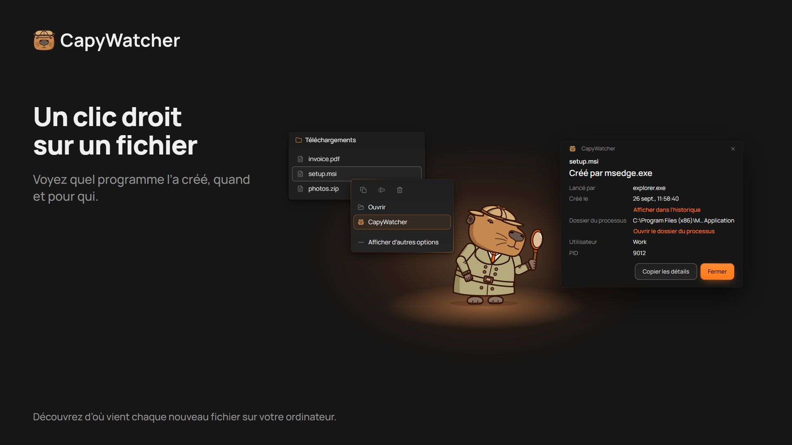
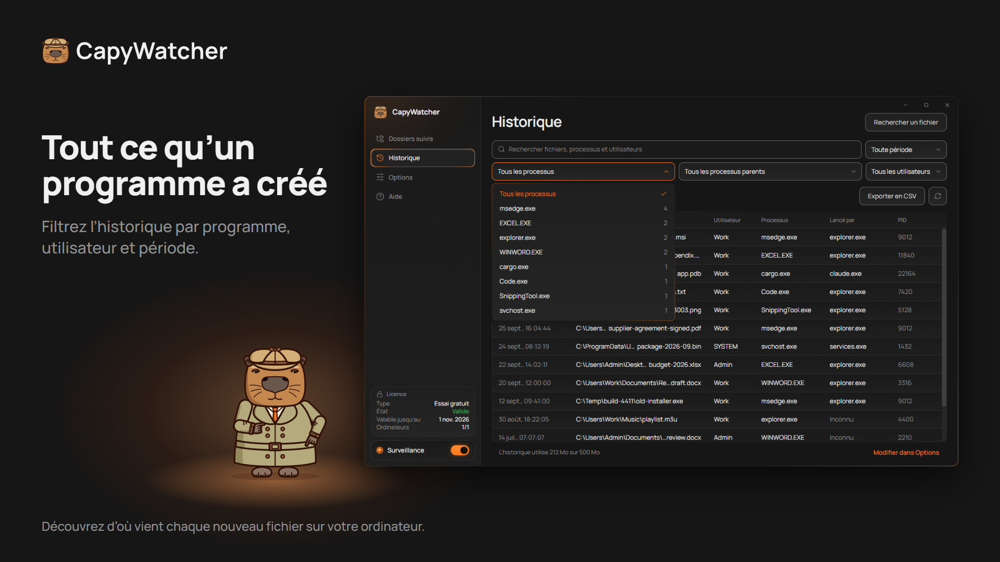

  

# CapyWatcher : qui a créé ce fichier ?

**Faites un clic droit sur un nouveau fichier dans Windows et voyez quel programme l’a créé, et quel agent IA a lancé ce programme.**

[Télécharger l’essai gratuit](https://capywatcher.com/fr/download) · [Voir les tarifs](https://capywatcher.com/fr/pricing) · [Lire les notes de version](https://capywatcher.com/fr/release-notes)

Windows 11, ou Windows 10 version 1803 ou ultérieure, 64 bits (x64). Gratuit pendant 7 jours, sans carte ni e-mail.

[English](README.md) · [Deutsch](README.de.md) · [Español](README.es.md) · Français · [Italiano](README.it.md) · [Polski](README.pl.md) · [Português (Brasil)](README.pt-BR.md) · [日本語](README.ja.md)

## À quoi il sert

Windows ne garde pas trace du programme qui a créé un fichier, et la plupart des outils ne voient que ce qui se passe pendant qu’on les regarde. CapyWatcher tourne en arrière-plan et enregistre chaque nouveau fichier dans les dossiers que vous choisissez : le programme qui l’a créé, le programme qui a lancé celui-ci, l’utilisateur et l’heure. Quand un fichier apparaît et que vous vous demandez d’où il vient, la réponse est déjà là.

Il est fait pour les personnes qui utilisent des agents IA de programmation comme Claude Code, Codex ou Cursor, pour les utilisateurs avancés de Windows face à des fichiers mystère, et pour toute personne qui veut savoir quel installateur, jeu, téléchargement ou script a déposé un fichier sur son ordinateur.

## Fonctionnalités

### La réponse au clic droit

Faites un clic droit sur un fichier dans l’Explorateur de fichiers (sous Windows 11, dans Afficher plus d’options) et sélectionnez CapyWatcher. Une petite fenêtre indique quel programme l’a créé, quand, pour quel utilisateur, et la chaîne des programmes qui l’ont lancé. Vous pouvez aussi rechercher un fichier depuis l’application, ou déposer des fichiers et des dossiers sur sa fenêtre.

### L’historique par programme

Partez d’un programme et voyez tous les fichiers qu’il a créés. Recherchez dans les chemins, les programmes et les utilisateurs, et filtrez par programme, processus parent, utilisateur et période, avec un compteur pour chacun. Masquez un processus qui crée des fichiers toute la journée (avec Annuler), et enregistrez les lignes filtrées dans un fichier CSV.

### Ce que votre agent IA a écrit

Un fichier écrit par `cargo.exe` ou `node.exe` indique aussi le programme qui l’a lancé, par exemple `claude.exe`. Vous voyez ainsi ce que votre agent IA a écrit, et où. Comme `git blame`, pour les nouveaux fichiers.

### Plusieurs fichiers et renommages

Sélectionnez plusieurs fichiers, faites un clic droit, et voyez le programme de chacun. Un téléchargement renommé à la fin indique toujours le navigateur qui l’a enregistré.

### Les dossiers de votre choix

Choisissez les dossiers à surveiller, sur n’importe quel lecteur de votre ordinateur. Un lecteur non connecté garde son réglage jusqu’à son retour.

### Un historique sous contrôle

Choisissez combien de temps l’historique est conservé, sa taille maximale, ce qui se passe à la limite et le dossier où il est enregistré. Supprimez-le en entier quand vous voulez.

### Discret, près de l’horloge

L’application démarre avec Windows dans la zone de notification, près de l’horloge. Des notifications Windows vous préviennent quand une mise à jour est prête et quand l’historique est presque plein, et les nouvelles versions peuvent s’installer toutes seules.

### À votre façon

Thèmes clair et sombre, et contraste élevé de Windows. Chaque vue se contrôle entièrement au clavier et avec un lecteur d’écran, et suit le réglage Taille du texte de Windows jusqu’à 225 %. Enregistrez vos paramètres dans un fichier et chargez-les sur un autre ordinateur.

### Léger pour votre ordinateur

Le service en arrière-plan utilise moins de 20 Mo de mémoire et moins de 1 % du processeur pendant qu’il enregistre les nouveaux fichiers.

### En 8 langues

Anglais, allemand, espagnol, français, italien, polonais, portugais (Brésil) et japonais. L’application utilise la langue de Windows quand elle la propose.

## Confidentialité

L’historique reste sur votre ordinateur, et le service qui surveille vos dossiers n’a pas accès au réseau. Pas de compte, pas de statistiques d’utilisation. Deux vérifications passent par Internet, vers le serveur de l’application : la vérification de licence et la recherche de mises à jour. Elles n’envoient jamais vos fichiers, votre historique ou le nom de votre ordinateur.

[Lire la politique de confidentialité](https://capywatcher.com/fr/privacy)

## Les limites, en toute franchise

- Il enregistre les nouveaux fichiers à partir de son installation, il ne peut donc rien dire des fichiers plus anciens.
- Il enregistre les fichiers créés ou renommés dans les dossiers suivis, pas les suppressions ni les modifications.
- Il ne fonctionne pas sur les lecteurs réseau, seulement sur les lecteurs de votre ordinateur.
- Il enregistre quel programme a créé un fichier. Il ne bloque rien.

## Prix

Essayez toutes les fonctions gratuitement pendant 7 jours, sans carte ni e-mail. Ensuite, 29 $ par an jusqu’à résiliation, ou 49 $ une fois. Chaque licence couvre jusqu’à 3 ordinateurs.

Les prix sont en dollars américains. Des taxes peuvent s’ajouter au paiement, selon votre pays de résidence.

[Voir les tarifs](https://capywatcher.com/fr/pricing)

## À propos de ce dépôt

CapyWatcher n’est pas open source : ce dépôt contient sa page de présentation, pas son code. Téléchargez l’application sur [capywatcher.com](https://capywatcher.com/fr/download).

## Aide et actualités

- E-mail : [support@capywatcher.com](mailto:support@capywatcher.com)
- X : [@CapyWatcherApp](https://x.com/CapyWatcherApp), pour les actualités et les messages privés
- Notes de version : [capywatcher.com/fr/release-notes](https://capywatcher.com/fr/release-notes), avec un [flux RSS](https://capywatcher.com/fr/release-notes/rss.xml)

## Créé par Admiral Capy

[Suivre @AdmiralCapy sur X](https://x.com/AdmiralCapy) · [En savoir plus sur le créateur](https://capywatcher.com/fr/about)
