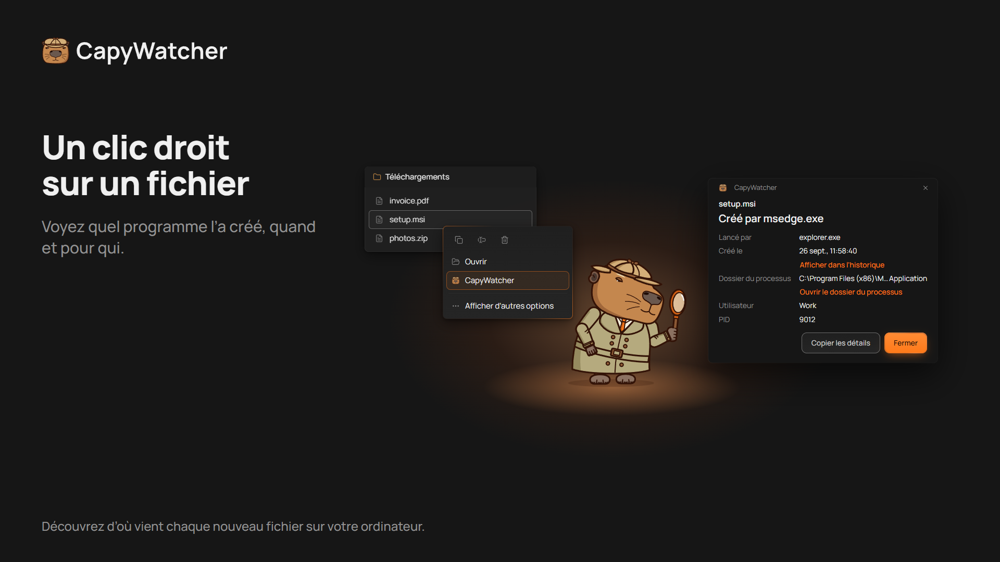
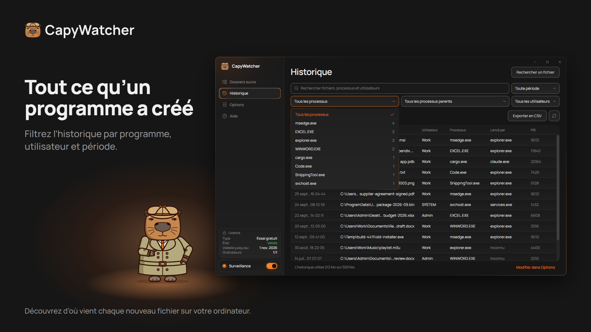

  <picture>
    <source media="(prefers-color-scheme: dark)" srcset="https://raw.githubusercontent.com/capywatcher/capywatcher/main/images/logo-dark.png">
    <source media="(prefers-color-scheme: light)" srcset="https://raw.githubusercontent.com/capywatcher/capywatcher/main/images/logo-light.png">
    
  </picture>

  <h1>CapyWatcher : qui a créé ce fichier ?</h1>

  
<strong>Faites un clic droit sur un nouveau fichier dans Windows et voyez quel programme l’a créé, et quel agent IA a lancé ce programme.</strong>

  
<a href="https://capywatcher.com/fr/download">Télécharger l’essai gratuit</a> &nbsp;·&nbsp; <a href="https://capywatcher.com/fr/pricing">Voir les tarifs</a> &nbsp;·&nbsp; <a href="https://capywatcher.com/fr/release-notes">Lire les notes de version</a>

  
Windows 11, ou Windows 10 version 1803 ou ultérieure, 64 bits (x64). Gratuit pendant 7 jours, sans carte ni e-mail.

  

    
    &nbsp;
    
    &nbsp;
    
  

  
<a href="README.md">English</a> &nbsp;·&nbsp; <a href="README.de.md">Deutsch</a> &nbsp;·&nbsp; <a href="README.es.md">Español</a> &nbsp;·&nbsp; Français &nbsp;·&nbsp; <a href="README.it.md">Italiano</a> &nbsp;·&nbsp; <a href="README.pl.md">Polski</a> &nbsp;·&nbsp; <a href="README.pt-BR.md">Português (Brasil)</a> &nbsp;·&nbsp; <a href="README.ja.md">日本語</a>

## À quoi il sert

Windows ne garde pas trace du programme qui a créé un fichier, et la plupart des outils ne voient que ce qui se passe pendant qu’on les regarde. CapyWatcher tourne en arrière-plan et enregistre chaque nouveau fichier dans les dossiers que vous choisissez : le programme qui l’a créé, le programme qui a lancé celui-ci, l’utilisateur et l’heure. Quand un fichier apparaît et que vous vous demandez d’où il vient, la réponse est déjà là.

Il est fait pour les personnes qui utilisent des agents IA de programmation comme Claude Code, Codex ou Cursor, pour les utilisateurs avancés de Windows face à des fichiers mystère, et pour toute personne qui veut savoir quel installateur, jeu, téléchargement ou script a déposé un fichier sur son ordinateur.

## Fonctionnalités

### La réponse au clic droit

Faites un clic droit sur un fichier dans l’Explorateur de fichiers (sous Windows 11, dans Afficher plus d’options) et sélectionnez CapyWatcher : qui a créé ce fichier ? Une petite fenêtre indique quel programme l’a créé, quand, pour quel utilisateur, et la chaîne des programmes qui l’ont lancé. Vous pouvez aussi rechercher un fichier depuis l’application, ou déposer des fichiers et des dossiers sur sa fenêtre.

### Le sous-menu de l’Explorateur

Un clic droit sur un fichier, un dossier ou un lecteur, clés USB et lecteurs réseau compris, ouvre le sous-menu CapyWatcher : l’afficher dans l’Historique, le suivre ou arrêter de le suivre, verrouiller ou déverrouiller un dossier, activer ou désactiver ses alertes de suppression.

### Qu’est-ce qui utilise ce fichier

Un clic droit sur un fichier ou un dossier montre chaque programme qui l’utilise, avec son icône, son nom et son utilisateur. Fermez un programme depuis cette liste, ou arrêtez-le s’il ne se ferme pas. Dans un dossier, l’application vérifie les 5 000 premiers fichiers.

### L’historique par programme

Partez d’un programme et voyez tous les fichiers qu’il a créés. Recherchez dans les chemins, les programmes et les utilisateurs, et filtrez par programme, processus parent, utilisateur et période, avec un compteur pour chacun. Masquez un processus qui crée des fichiers toute la journée (avec Annuler), et enregistrez les lignes filtrées dans un fichier CSV.

### Ce que votre agent IA a écrit

Un fichier écrit par `cargo.exe` ou `node.exe` indique aussi le programme qui l’a lancé, par exemple `claude.exe`. Vous voyez ainsi ce que votre agent IA a écrit, et où. Comme `git blame`, pour les nouveaux fichiers.

### Plusieurs fichiers et renommages

Sélectionnez plusieurs fichiers, faites un clic droit, et voyez le programme de chacun. Un téléchargement renommé à la fin indique toujours le navigateur qui l’a enregistré.

### Les dossiers de votre choix

Choisissez les dossiers à surveiller, sur n’importe quel lecteur de votre ordinateur, une clé USB, ou un lecteur réseau ou un partage que vous ajoutez. Un lecteur non connecté garde son réglage jusqu’à son retour. Dossiers suivis indique aussi combien de fichiers ont été créés et supprimés dans chacun : aujourd’hui, sur 7 ou 30 jours, ou depuis le début du suivi.

### Verrous et alertes de suppression

Chaque dossier suivi a son propre cadenas et sa propre cloche, et vous pouvez utiliser l’un des deux ou les deux. Verrouillez un dossier suivi, et rien ne peut supprimer, déplacer ou renommer ses fichiers tant que vous ne l’avez pas déverrouillé. Un programme exécuté en tant qu’administrateur peut retirer le verrou, et CapyWatcher le remet en moins de 2 secondes et vous prévient. Activez la cloche d’un dossier suivi, et une notification Windows indique quel programme a supprimé des fichiers et combien, avec un bouton pour l’arrêter.

### Un historique sous contrôle

Choisissez combien de temps l’historique est conservé, sa taille maximale, ce qui se passe à la limite et le dossier où il est enregistré. Supprimez-le en entier quand vous voulez.

### Discret, près de l’horloge

L’application démarre avec Windows dans la zone de notification, près de l’horloge. Des notifications Windows vous préviennent quand une mise à jour est prête et quand l’historique est presque plein, et les nouvelles versions peuvent s’installer toutes seules.

### À votre façon

Thèmes clair et sombre, et contraste élevé de Windows. Chaque vue se contrôle entièrement au clavier et avec un lecteur d’écran, et suit le réglage Taille du texte de Windows jusqu’à 225 %. Enregistrez vos paramètres dans un fichier et chargez-les sur un autre ordinateur.

### Léger pour votre ordinateur

Le service en arrière-plan utilise environ 8 Mo de mémoire. L’application utilise environ 4 Mo et presque pas de processeur dans la zone de notification, 23 Mo réduite et 50 à 90 Mo avec sa fenêtre ouverte. Le service reste proche de 0 % du processeur au repos et à environ 1 % même quand des milliers de fichiers sont écrits chaque seconde. Mesuré dans le Gestionnaire des tâches sous Windows 11 avec 12 cœurs.

### En 8 langues

Anglais, allemand, espagnol, français, italien, polonais, portugais (Brésil) et japonais. L’application utilise la langue de Windows quand elle la propose.

## Confidentialité

L’historique reste sur votre ordinateur, et le service qui surveille vos dossiers n’a pas accès au réseau. Il y est chiffré : les autres programmes ne peuvent pas le lire, et une copie ne s’ouvre sur aucun autre ordinateur, même équipé de CapyWatcher avec une licence valide. Pas de compte, pas de statistiques d’utilisation. Deux vérifications passent par Internet, vers le serveur de l’application : la vérification de licence et la recherche de mises à jour. Elles n’envoient jamais vos fichiers, votre historique ou le nom de votre ordinateur.

[Lire la politique de confidentialité](https://capywatcher.com/fr/privacy)

## Les limites, en toute franchise

- Il enregistre les nouveaux fichiers à partir de son installation, il ne peut donc rien dire des fichiers plus anciens.
- L’Historique enregistre les fichiers créés ou renommés dans les dossiers suivis, pas les suppressions ni les modifications.
- Sur un lecteur réseau ou un partage, il n’enregistre que ce que font les programmes de votre ordinateur.
- Il enregistre quel programme a créé un fichier. Un dossier verrouillé refuse les suppressions, les déplacements et les changements de nom, pas les nouveaux fichiers.

## Prix

Essayez toutes les fonctions gratuitement pendant 7 jours, sans carte ni e-mail. Ensuite, un seul paiement : 49 $ pour jusqu’à 3 ordinateurs, ou à partir de 13,30 $ par ordinateur avec la formule flexible.

Les prix sont en dollars américains. Des taxes peuvent s’ajouter au paiement, selon votre pays de résidence.

[Voir les tarifs](https://capywatcher.com/fr/pricing)

## À propos de ce dépôt

CapyWatcher n’est pas open source : ce dépôt contient sa page de présentation, pas son code. Téléchargez l’application sur [capywatcher.com](https://capywatcher.com/fr/download).

Tous droits réservés. Les [conditions d’utilisation](https://capywatcher.com/fr/terms#ip) disent ce que vous pouvez faire avec l’application.

## Aide et actualités

- E-mail : [support@capywatcher.com](mailto:support@capywatcher.com)
- X : [@CapyWatcherApp](https://x.com/CapyWatcherApp), pour les actualités et les messages privés
- Notes de version : [capywatcher.com/fr/release-notes](https://capywatcher.com/fr/release-notes), avec un [flux RSS](https://capywatcher.com/fr/release-notes/rss.xml)
- Blog : [capywatcher.com/fr/blog](https://capywatcher.com/fr/blog), avec un [flux RSS](https://capywatcher.com/fr/blog/rss.xml)

## Créé par Admiral Capy

[Suivre @AdmiralCapy sur X](https://x.com/AdmiralCapy) · [En savoir plus sur le créateur](https://capywatcher.com/fr/about)
