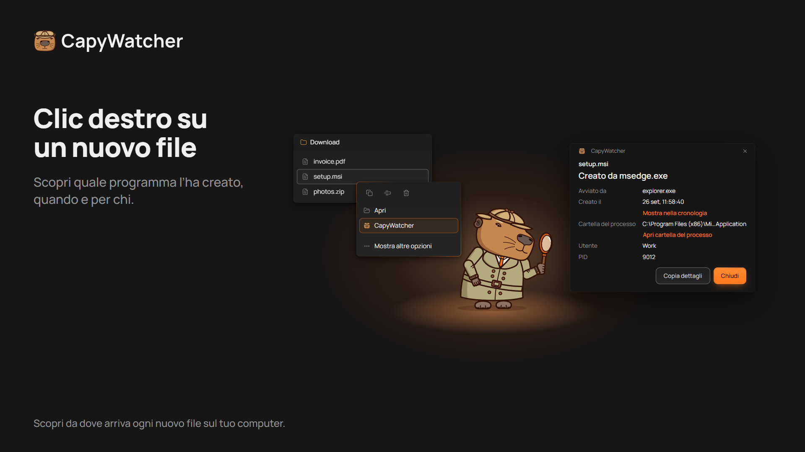
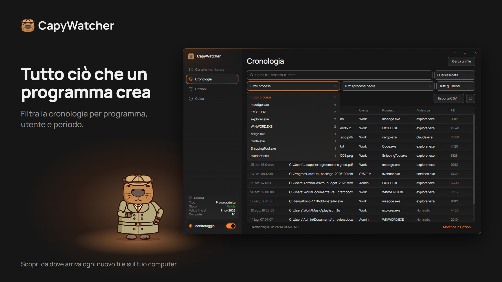

  <picture>
    <source media="(prefers-color-scheme: dark)" srcset="https://raw.githubusercontent.com/capywatcher/capywatcher/main/images/logo-dark.png">
    <source media="(prefers-color-scheme: light)" srcset="https://raw.githubusercontent.com/capywatcher/capywatcher/main/images/logo-light.png">
    
  </picture>

  <h1>CapyWatcher: chi ha creato questo file?</h1>

  
<strong>Fai clic destro su un nuovo file in Windows e scopri quale programma l’ha creato, e quale agente IA ha avviato quel programma.</strong>

  
<a href="https://capywatcher.com/it/download">Scarica la prova gratuita</a> &nbsp;·&nbsp; <a href="https://capywatcher.com/it/pricing">Vedi i prezzi</a> &nbsp;·&nbsp; <a href="https://capywatcher.com/it/release-notes">Leggi le note di rilascio</a>

  
Windows 11, o Windows 10 versione 1803 o successiva, a 64 bit (x64). Gratis per 7 giorni, senza carta e senza email.

  

    
    &nbsp;
    
    &nbsp;
    
  

  
<a href="README.md">English</a> &nbsp;·&nbsp; <a href="README.de.md">Deutsch</a> &nbsp;·&nbsp; <a href="README.es.md">Español</a> &nbsp;·&nbsp; <a href="README.fr.md">Français</a> &nbsp;·&nbsp; Italiano &nbsp;·&nbsp; <a href="README.pl.md">Polski</a> &nbsp;·&nbsp; <a href="README.pt-BR.md">Português (Brasil)</a> &nbsp;·&nbsp; <a href="README.ja.md">日本語</a>

## A cosa serve

Windows non tiene traccia del programma che ha creato un file, e la maggior parte degli strumenti vede solo ciò che succede mentre li guardi. CapyWatcher lavora in background e registra ogni nuovo file nelle cartelle che scegli: il programma che l’ha creato, il programma che ha avviato quello, l’utente e l’ora. Quando compare un file e ti chiedi da dove arrivi, la risposta è già lì.

È pensato per chi usa agenti IA di programmazione come Claude Code, Codex o Cursor, per gli utenti esperti di Windows alle prese con file misteriosi, e per chiunque voglia sapere quale installer, gioco, download o script ha messo un file sul suo computer.

## Funzioni

### La risposta col clic destro

Fai clic destro su un file in Esplora file (in Windows 11, sotto Mostra altre opzioni) e seleziona CapyWatcher: chi ha creato questo file? Una piccola finestra mostra quale programma l’ha creato, quando, per quale utente, e la catena di programmi che l’ha avviato. Puoi anche cercare un file dall’app, o trascinare file e cartelle sulla sua finestra.

### Il sottomenu di Esplora file

Fai clic destro su un file, una cartella o un’unità, anche pendrive e unità di rete, per il sottomenu di CapyWatcher: mostrarlo in Cronologia, monitorarlo o smettere di farlo, bloccare o sbloccare una cartella e attivare o disattivare i suoi avvisi di eliminazione.

### Cosa sta usando questo file

Fai clic destro su un file o una cartella per vedere ogni programma che lo usa, con icona, nome e utente. Chiudi un programma da lì, o arrestalo se non si chiude. In una cartella, l’app controlla i primi 5.000 file.

### La cronologia per programma

Parti da un programma e vedi ogni file che ha creato. Cerca tra percorsi, programmi e utenti, e filtra per programma, processo padre, utente e intervallo di tempo, con un conteggio accanto a ciascuno. Nascondi un processo che crea file tutto il giorno (con Annulla) e salva le righe filtrate in un file CSV.

### Cosa ha scritto il tuo agente IA

Un file scritto da `cargo.exe` o `node.exe` indica anche il programma che l’ha avviato, per esempio `claude.exe`. Così vedi cosa ha scritto il tuo agente IA, e dove. Come `git blame`, per i nuovi file.

### Più file e rinomine

Seleziona più file, fai clic destro, e vedi il programma di ciascuno. Un download rinominato alla fine indica ancora il browser che l’ha salvato.

### Le cartelle che scegli tu

Scegli le cartelle da monitorare, su qualsiasi unità del tuo computer, un pendrive, o un’unità di rete o una condivisione che aggiungi. Un’unità non collegata conserva la sua impostazione finché non torna. Cartelle monitorate mostra anche quanti file sono stati creati ed eliminati in ognuna: oggi, in 7 o 30 giorni, o da quando è iniziato il monitoraggio.

### Blocchi e avvisi di eliminazione

Ogni cartella monitorata ha il suo lucchetto e la sua campanella, e puoi usare uno dei due o entrambi. Blocca una cartella monitorata, e niente potrà eliminare, spostare o rinominare i suoi file finché non la sblocchi. Un programma eseguito come amministratore può togliere il blocco, e CapyWatcher lo rimette entro 2 secondi e te lo dice. Attiva la campanella di una cartella monitorata, e una notifica di Windows dice quale programma ha eliminato file e quanti, con un pulsante per arrestarlo.

### Una cronologia sotto controllo

Scegli per quanto tempo conservare la cronologia, quanto può crescere, cosa succede al limite e in quale cartella viene salvata. Eliminala tutta quando vuoi.

### Discreta, vicino all’orologio

L’app si avvia con Windows nell’area di notifica, vicino all’orologio. Le notifiche di Windows ti avvisano quando un aggiornamento è pronto e quando la cronologia è quasi piena, e le nuove versioni possono installarsi da sole.

### Come lavori tu

Temi chiaro e scuro, e contrasto elevato di Windows. Ogni vista si usa del tutto da tastiera e con un lettore di schermo, e segue l’impostazione Dimensioni testo di Windows fino al 225 %. Salva le impostazioni in un file e caricale su un altro computer.

### Leggera per il tuo computer

Il servizio in background usa circa 8 MB di memoria. L’app usa circa 4 MB e quasi niente CPU nell’area di notifica, 23 MB ridotta a icona e da 50 a 90 MB con la finestra aperta. Il servizio resta vicino allo 0 % della CPU a riposo e intorno all’1 % anche quando vengono scritti migliaia di file al secondo. Misurato in Gestione attività su Windows 11 con 12 core.

### In 8 lingue

Inglese, tedesco, spagnolo, francese, italiano, polacco, portoghese (Brasile) e giapponese. L’app usa la lingua di Windows se la include.

## Privacy

La cronologia resta sul tuo computer, e il servizio che controlla le cartelle non ha accesso alla rete. Lì è cifrata, quindi gli altri programmi non possono leggerla, e una copia non si apre su nessun altro computer, nemmeno su uno con CapyWatcher e una licenza valida. Nessun account e nessuna statistica d’uso. Due controlli vanno online, verso il server dell’app: il controllo della licenza e la ricerca di aggiornamenti. Non inviano mai i tuoi file, la tua cronologia o il nome del computer.

[Leggi l’informativa sulla privacy](https://capywatcher.com/it/privacy)

## I limiti, in tutta onestà

- Registra i nuovi file dal momento in cui lo installi, quindi non può dirti nulla dei file precedenti.
- La Cronologia registra i file creati o rinominati nelle cartelle monitorate, non le eliminazioni né le modifiche.
- Su un’unità di rete o una condivisione, registra solo ciò che fanno i programmi del tuo computer.
- Registra quale programma ha creato un file. Una cartella bloccata rifiuta eliminazioni, spostamenti e cambi di nome, non i nuovi file.

## Prezzo

Prova ogni funzione gratis per 7 giorni, senza carta e senza email. Poi paghi una volta sola: 49 $ per fino a 3 computer, o da 13,30 $ a computer con il piano flessibile.

I prezzi sono in dollari statunitensi. Al pagamento possono aggiungersi delle imposte, a seconda di dove vivi.

[Vedi i prezzi](https://capywatcher.com/it/pricing)

## Questo repository

CapyWatcher non è open source, quindi questo repository contiene la sua pagina di presentazione, non il suo codice. Scarica l’app da [capywatcher.com](https://capywatcher.com/it/download).

Tutti i diritti riservati. Le [condizioni d’uso](https://capywatcher.com/it/terms#ip) dicono cosa puoi fare con l’app.

## Aiuto e novità

- Email: [support@capywatcher.com](mailto:support@capywatcher.com)
- X: [@CapyWatcherApp](https://x.com/CapyWatcherApp), per novità e messaggi diretti
- Note di rilascio: [capywatcher.com/it/release-notes](https://capywatcher.com/it/release-notes), con un [feed RSS](https://capywatcher.com/it/release-notes/rss.xml)
- Blog: [capywatcher.com/it/blog](https://capywatcher.com/it/blog), con un [feed RSS](https://capywatcher.com/it/blog/rss.xml)

## Creato da Admiral Capy

[Segui @AdmiralCapy su X](https://x.com/AdmiralCapy) · [Leggi chi è il creatore](https://capywatcher.com/it/about)
