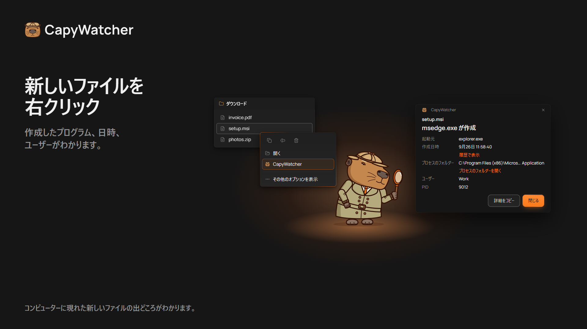
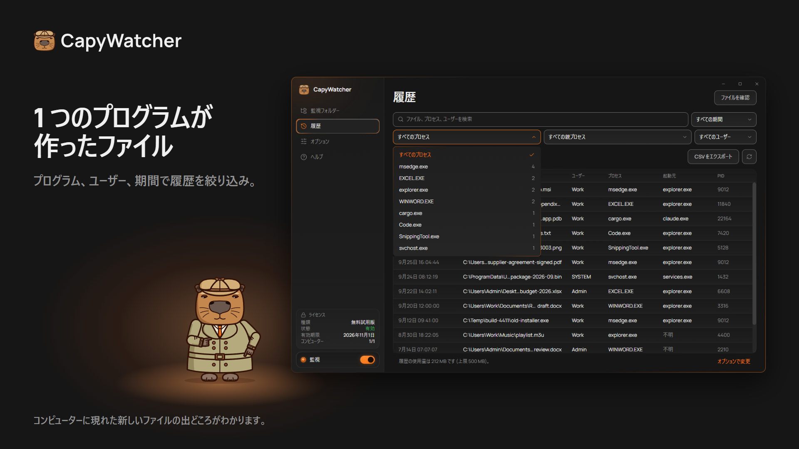

  <picture>
    <source media="(prefers-color-scheme: dark)" srcset="https://raw.githubusercontent.com/capywatcher/capywatcher/main/images/logo-dark.png">
    <source media="(prefers-color-scheme: light)" srcset="https://raw.githubusercontent.com/capywatcher/capywatcher/main/images/logo-light.png">
    
  </picture>

  <h1>CapyWatcher: ファイルを作成したプログラムがわかる</h1>

  
<strong>Windows で新しいファイルを右クリックすると、作成したプログラムと、そのプログラムを起動した AI エージェントがわかります。</strong>

  
<a href="https://capywatcher.com/ja/download">無料試用版をダウンロード</a> &nbsp;·&nbsp; <a href="https://capywatcher.com/ja/pricing">価格を見る</a> &nbsp;·&nbsp; <a href="https://capywatcher.com/ja/release-notes">リリース ノートを読む</a>

  
Windows 11、または Windows 10 バージョン 1803 以降の 64 ビット版 (x64)。7 日間無料で、カードもメール アドレスも不要です。

  

    
    &nbsp;
    
    &nbsp;
    
  

  
<a href="README.md">English</a> &nbsp;·&nbsp; <a href="README.de.md">Deutsch</a> &nbsp;·&nbsp; <a href="README.es.md">Español</a> &nbsp;·&nbsp; <a href="README.fr.md">Français</a> &nbsp;·&nbsp; <a href="README.it.md">Italiano</a> &nbsp;·&nbsp; <a href="README.pl.md">Polski</a> &nbsp;·&nbsp; <a href="README.pt-BR.md">Português (Brasil)</a> &nbsp;·&nbsp; 日本語

## 何のためのアプリか

Windows は、どのプログラムがファイルを作成したかを記録しません。多くのツールも、見ている間に起きたことしかわかりません。CapyWatcher はバックグラウンドで動き、選んだフォルダーにできた新しいファイルを記録します。作成したプログラム、そのプログラムを起動したプログラム、ユーザー、時刻です。見覚えのないファイルが現れたとき、答えはもう記録されています。

Claude Code、Codex、Cursor などの AI コーディング エージェントを使う人、正体不明のファイルに悩む Windows の上級ユーザー、どのインストーラー、ゲーム、ダウンロード、スクリプトがファイルを置いたのか知りたいすべての人のためのアプリです。

## 機能

### 右クリックで答え

エクスプローラーでファイルを右クリックし (Windows 11 では [その他のオプションを確認] の中)、CapyWatcher を選びます。小さなウィンドウに、作成したプログラム、日時、ユーザー、そしてそれを起動したプログラムの連なりが表示されます。アプリの中からファイルを確認したり、ファイルやフォルダーをウィンドウにドロップしたりもできます。

### プログラムごとの履歴

プログラムから調べると、そのプログラムが作成したファイルをすべて表示します。ファイルのパス、プログラム、ユーザーで検索し、プログラム、親プロセス、ユーザー、期間で絞り込めます。それぞれに件数が付きます。一日中ファイルを作り続けるプロセスは非表示にでき ([元に戻す] もできます)、絞り込んだ行は CSV ファイルに保存できます。

### AI エージェントが書いたファイル

`cargo.exe` や `node.exe` が書いたファイルには、それを起動したプログラム (たとえば `claude.exe`) も表示されます。AI エージェントが何をどこに書いたかがわかります。新しいファイルのための `git blame` です。

### 複数のファイルと名前の変更

複数のファイルを選んで右クリックすると、それぞれのプログラムがわかります。ダウンロードの最後に名前が変わったファイルでも、保存したブラウザーがわかります。

### 選んだフォルダーだけ

監視するフォルダーを、コンピューターのどのドライブからでも選べます。接続されていないドライブの設定は、戻るまで残ります。

### ロックと削除通知

監視フォルダーごとに鍵とベルがあり、どちらか一方だけでも、両方でも使えます。監視フォルダーをロックすると、ロックを解除するまで、中のファイルを削除、移動、名前変更できなくなります。管理者として実行しているプログラムはロックを解除できます。監視フォルダーのベルをオンにすると、どのプログラムが何個のファイルを削除したかを Windows の通知でお知らせします。通知のボタンでそのプログラムを停止できます。

### 履歴は自分で管理

履歴の保存期間、サイズの上限、上限に達したときの動作、保存先のフォルダーを選べます。いつでもすべて削除できます。

### 時計の横で静かに

アプリは Windows と同時に、時計の横のトレイで起動します。更新の準備ができたときと履歴がいっぱいに近づいたときは Windows の通知で知らせ、新しいバージョンは自動でインストールすることもできます。

### 使い方に合わせて

ライトとダークのテーマ、Windows のハイコントラストに対応しています。すべての画面をキーボードだけで操作でき、スクリーン リーダーにも対応しています。Windows の [テキストのサイズ] の設定に、最大 225 % まで従います。設定をファイルに保存して、別のコンピューターで読み込めます。

### コンピューターに軽い

バックグラウンドのサービスは、新しいファイルを記録している間もメモリ 20 MB 未満、CPU 1 % 未満で動きます。

### 8 つの言語

英語、ドイツ語、スペイン語、フランス語、イタリア語、ポーランド語、ポルトガル語 (ブラジル)、日本語です。Windows の表示言語に対応していれば、その言語を使います。

## プライバシー

履歴はコンピューターの中に残り、フォルダーを監視するサービスはネットワークにアクセスしません。アカウントも利用状況の統計もありません。インターネットに接続するのは、アプリのサーバーへの 2 つの確認だけです。ライセンスの確認と更新の確認です。ファイル、履歴、コンピューター名は送りません。

[プライバシー ポリシーを読む](https://capywatcher.com/ja/privacy)

## 正直に言うと

- インストールした時点から新しいファイルを記録するので、それ以前のファイルについてはわかりません。
- [履歴] に記録するのは監視フォルダーで作成または名前変更されたファイルで、削除や編集は記録しません。
- ネットワーク ドライブでは動作しません。コンピューター内のドライブだけが対象です。
- 記録するのは、どのプログラムがファイルを作成したかです。ロックしたフォルダーは削除、移動、名前変更を拒否しますが、新しいファイルの作成は拒否しません。

## 価格

カードもメール アドレスも不要で、7 日間すべての機能を無料で試せます。その後は年 $29 (解約するまで毎年更新) か、買い切り $49 です。どちらもコンピューター 3 台まで使えます。

価格は米ドルです。お住まいの地域によっては、購入時に税金が加算されます。

[価格を見る](https://capywatcher.com/ja/pricing)

## このリポジトリについて

CapyWatcher はソースコードを公開していないため、このリポジトリにあるのは製品紹介のページで、コードではありません。アプリは [capywatcher.com](https://capywatcher.com/ja/download) からダウンロードできます。

## サポートとお知らせ

- メール: [support@capywatcher.com](mailto:support@capywatcher.com)
- X: [@CapyWatcherApp](https://x.com/CapyWatcherApp) (お知らせと DM)
- リリース ノート: [capywatcher.com/ja/release-notes](https://capywatcher.com/ja/release-notes) ([RSS フィード](https://capywatcher.com/ja/release-notes/rss.xml)もあります)

## 作者は Admiral Capy

[X で @AdmiralCapy をフォロー](https://x.com/AdmiralCapy) · [作者について読む](https://capywatcher.com/ja/about)
