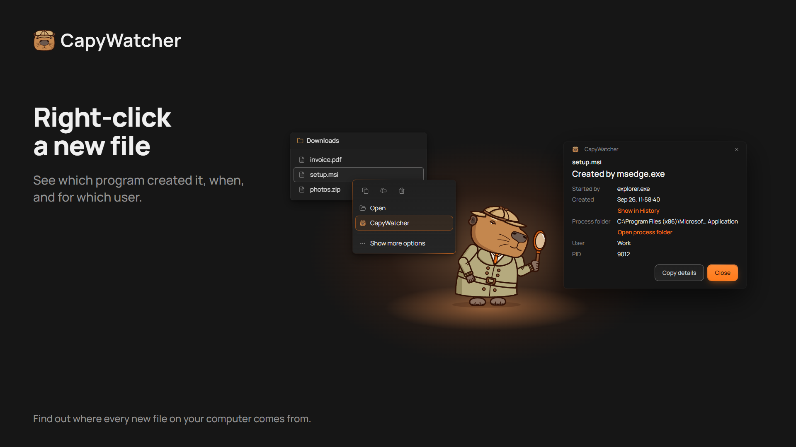
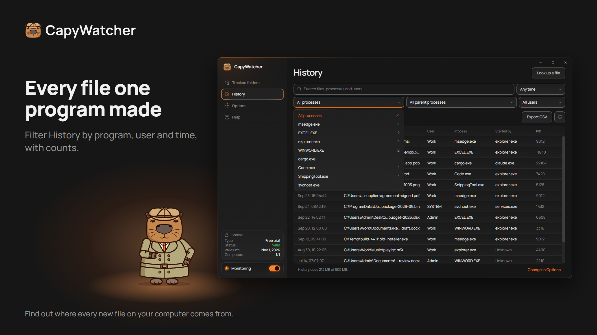

  <picture>
    <source media="(prefers-color-scheme: dark)" srcset="https://raw.githubusercontent.com/capywatcher/capywatcher/main/images/logo-dark.png">
    <source media="(prefers-color-scheme: light)" srcset="https://raw.githubusercontent.com/capywatcher/capywatcher/main/images/logo-light.png">
    
  </picture>

  <h1>CapyWatcher: who created this file?</h1>

  
<strong>Right-click a new file in Windows and see which program created it, and which AI agent started that program.</strong>

  
<a href="https://capywatcher.com/en/download">Download the free trial</a> &nbsp;·&nbsp; <a href="https://capywatcher.com/en/pricing">See pricing</a> &nbsp;·&nbsp; <a href="https://capywatcher.com/en/release-notes">Read the release notes</a>

  
Windows 11, or Windows 10 version 1803 or later, 64-bit (x64). Free for 7 days, with no card and no email.

  

    
    &nbsp;
    
    &nbsp;
    
  

  
English &nbsp;·&nbsp; <a href="README.de.md">Deutsch</a> &nbsp;·&nbsp; <a href="README.es.md">Español</a> &nbsp;·&nbsp; <a href="README.fr.md">Français</a> &nbsp;·&nbsp; <a href="README.it.md">Italiano</a> &nbsp;·&nbsp; <a href="README.pl.md">Polski</a> &nbsp;·&nbsp; <a href="README.pt-BR.md">Português (Brasil)</a> &nbsp;·&nbsp; <a href="README.ja.md">日本語</a>

## What it's for

Windows doesn't keep a record of which program created a file, and most tools only see what happens while you watch them. CapyWatcher runs in the background and records every new file in the folders you choose: the program that created it, the program that started that one, the user and the time. When a file turns up and you wonder where it came from, the answer is already there.

It's made for people who run AI coding agents such as Claude Code, Codex or Cursor, for Windows power users with mystery files, and for anyone who wants to know which installer, game, download or script put a file on their computer.

## Features

### The right-click answer

Right-click a file in File Explorer (on Windows 11, under Show more options) and select CapyWatcher. A small window shows which program created it, when, for which user, and the chain of programs that started it. You can also look up a file from inside the app, or drop files and folders on its window.

### History by program

Start from a program and see every file it created. Search file paths, programs and users, and filter by program, parent process, user and time range, with a count next to each one. Hide a process that creates files all day, with Undo, and save the filtered rows as a CSV file.

### What your AI agent wrote

A file written by `cargo.exe` or `node.exe` also names the program that started it, such as `claude.exe`. So you can see what your AI agent wrote and where. Like `git blame`, for new files.

### Several files and renames

Select several files, right-click, and see each one's program. A download renamed when it finishes still names the browser that saved it.

### Only the folders you choose

Choose the folders to track, on any drive in your computer. A drive that isn't connected keeps its setting until it's back.

### Locks and delete alerts

Each tracked folder has its own lock and its own bell, and you can use either one or both. Lock a tracked folder, and nothing can delete, move or rename its files until you unlock it. A program running as administrator can remove the lock. Turn on a tracked folder’s bell, and a Windows notification says which program deleted files and how many, with a button to stop it.

### A history you control

Choose how long history is kept, how big it can get, what happens at the limit and which folder it's saved in. Delete it all whenever you like.

### Quiet in the tray

The app starts with Windows in the notification area, next to the clock. Windows notifications tell you when an update is ready and when history is almost full, and new versions can install by themselves.

### For the way you work

Light and dark themes, and Windows High Contrast. Every view works from the keyboard and with a screen reader, and follows Windows' Text size setting up to 225%. Save your settings to a file and load them on another computer.

### Light on your computer

The background service uses under 20 MB of memory and less than 1% CPU while it records new files.

### In 8 languages

English, German, Spanish, French, Italian, Polish, Portuguese (Brazil) and Japanese. The app uses your Windows language when it has it.

## Privacy

The history stays on your computer, and the service that watches your folders has no network access. There's no account and no analytics. Two checks go online, to the app's own server: the license check and the update check. They never send your files, your history or your computer's name.

[Read the privacy policy](https://capywatcher.com/en/privacy)

## The honest limits

- It records new files from the moment you install it, so it can't tell you about older ones.
- History records files created or renamed in the folders you track, not deletions or edits.
- It doesn't work on network drives, only on drives in your computer.
- It records which program created a file. A locked folder refuses deletes, moves and renames, not new files.

## Price

Try every feature free for 7 days, with no card and no email. Then $29 a year until you cancel, or $49 once. Each license covers up to 3 computers.

Prices are in US dollars. Tax may be added at checkout, depending on where you live.

[See pricing](https://capywatcher.com/en/pricing)

## About this repository

CapyWatcher is closed source, so this repository holds its product page, not its code. Download the app from [capywatcher.com](https://capywatcher.com/en/download).

## Help and news

- Email: [support@capywatcher.com](mailto:support@capywatcher.com)
- X: [@CapyWatcherApp](https://x.com/CapyWatcherApp), for news and DMs
- Release notes: [capywatcher.com/en/release-notes](https://capywatcher.com/en/release-notes), with an [RSS feed](https://capywatcher.com/en/release-notes/rss.xml)

## Made by Admiral Capy

[Follow @AdmiralCapy on X](https://x.com/AdmiralCapy) · [Read about the maker](https://capywatcher.com/en/about)
