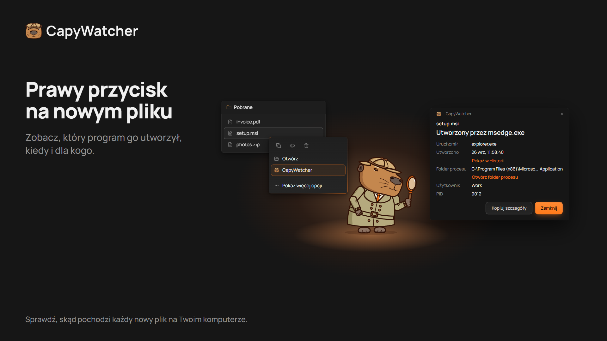
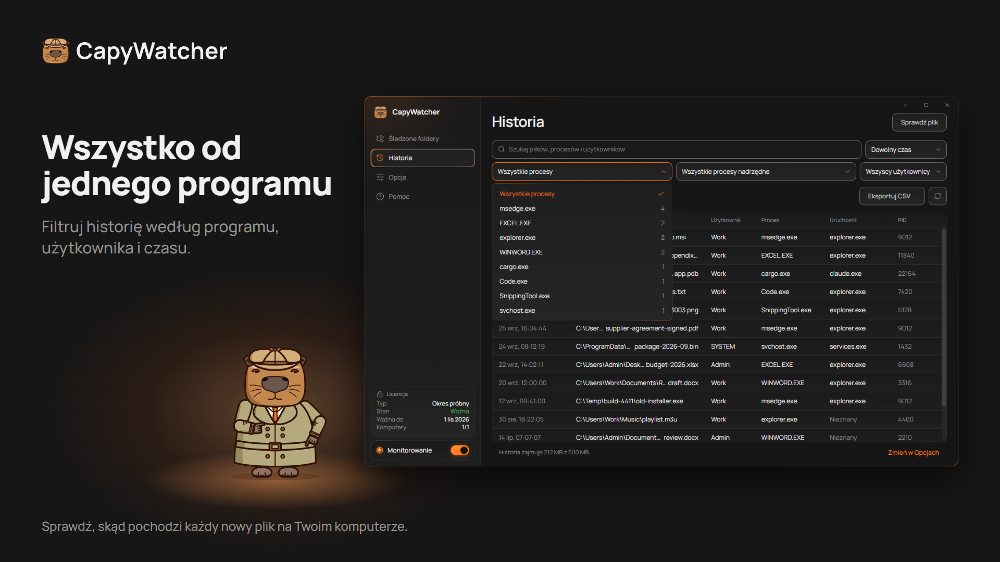

  <picture>
    <source media="(prefers-color-scheme: dark)" srcset="https://raw.githubusercontent.com/capywatcher/capywatcher/main/images/logo-dark.png">
    <source media="(prefers-color-scheme: light)" srcset="https://raw.githubusercontent.com/capywatcher/capywatcher/main/images/logo-light.png">
    
  </picture>

  <h1>CapyWatcher: kto utworzył ten plik?</h1>

  
<strong>Kliknij nowy plik w Windows prawym przyciskiem i zobacz, który program go utworzył i jaki agent AI ten program uruchomił.</strong>

  
<a href="https://capywatcher.com/pl/download">Pobierz wersję próbną</a> &nbsp;·&nbsp; <a href="https://capywatcher.com/pl/pricing">Zobacz cennik</a> &nbsp;·&nbsp; <a href="https://capywatcher.com/pl/release-notes">Przeczytaj informacje o wersji</a>

  
Windows 11 albo Windows 10 w wersji 1803 lub nowszej, 64-bitowy (x64). 7 dni za darmo, bez karty i bez e-maila.

  

    
    &nbsp;
    
    &nbsp;
    
  

  
<a href="README.md">English</a> &nbsp;·&nbsp; <a href="README.de.md">Deutsch</a> &nbsp;·&nbsp; <a href="README.es.md">Español</a> &nbsp;·&nbsp; <a href="README.fr.md">Français</a> &nbsp;·&nbsp; <a href="README.it.md">Italiano</a> &nbsp;·&nbsp; Polski &nbsp;·&nbsp; <a href="README.pt-BR.md">Português (Brasil)</a> &nbsp;·&nbsp; <a href="README.ja.md">日本語</a>

## Do czego służy

Windows nie zapisuje, który program utworzył plik, a większość narzędzi widzi tylko to, co dzieje się, gdy na nie patrzysz. CapyWatcher działa w tle i zapisuje każdy nowy plik w wybranych folderach: program, który go utworzył, program, który uruchomił ten program, użytkownika i godzinę. Gdy pojawi się plik i zastanawiasz się, skąd się wziął, odpowiedź już czeka.

Dla osób, które pracują z agentami AI do programowania, takimi jak Claude Code, Codex czy Cursor, dla zaawansowanych użytkowników Windows z tajemniczymi plikami i dla każdego, kto chce wiedzieć, który instalator, gra, pobrany plik czy skrypt zostawił plik na komputerze.

## Funkcje

### Odpowiedź pod prawym przyciskiem

Kliknij plik prawym przyciskiem w Eksploratorze plików (w Windows 11 w Pokaż więcej opcji) i wybierz CapyWatcher. Małe okno pokazuje, który program go utworzył, kiedy, dla którego użytkownika, i łańcuch programów, które go uruchomiły. Możesz też sprawdzić plik w aplikacji albo upuścić pliki i foldery na jej okno.

### Historia według programu

Zacznij od programu i zobacz każdy plik, który utworzył. Szukaj w ścieżkach, programach i użytkownikach oraz filtruj według programu, procesu nadrzędnego, użytkownika i przedziału czasu, z liczbą przy każdym. Ukryj proces, który tworzy pliki przez cały dzień (z Cofnij), i zapisz przefiltrowane wiersze w pliku CSV.

### Co zapisał Twój agent AI

Plik zapisany przez `cargo.exe` albo `node.exe` wskazuje też program, który go uruchomił, na przykład `claude.exe`. Widzisz więc, co i gdzie zapisał Twój agent AI. Jak `git blame`, dla nowych plików.

### Kilka plików i zmiany nazw

Zaznacz kilka plików, kliknij prawym przyciskiem i zobacz program każdego z nich. Pobrany plik, którego nazwa zmienia się na końcu, nadal wskazuje przeglądarkę, która go zapisała.

### Tylko wybrane foldery

Wybierz foldery do obserwowania, na dowolnym dysku w Twoim komputerze. Odłączony dysk zachowuje swoje ustawienia do czasu, aż znów go podłączysz.

### Blokady i alerty o usuwaniu

Każdy śledzony folder ma własną kłódkę i własny dzwonek. Możesz użyć jednego, drugiego albo obu naraz. Zablokuj śledzony folder, a nic nie będzie mogło usuwać, przenosić ani zmieniać nazw jego plików, dopóki go nie odblokujesz. Program uruchomiony jako administrator może zdjąć blokadę. Włącz dzwonek śledzonego folderu, a powiadomienie Windows powie, który program usunął pliki i ile, z przyciskiem, by go zatrzymać.

### Historia pod Twoją kontrolą

Wybierz, jak długo przechowywać historię, jak duża może być, co się dzieje po osiągnięciu limitu i w którym folderze jest zapisana. Usuń ją całą, kiedy chcesz.

### Cicho, obok zegara

Aplikacja uruchamia się z Windows w zasobniku obok zegara. Powiadomienia Windows dają znać, gdy czeka aktualizacja i gdy historia jest prawie pełna, a nowe wersje mogą instalować się same.

### Po Twojemu

Jasny i ciemny motyw oraz kontrast Windows. Każdy widok obsłużysz w całości klawiaturą i czytnikiem ekranu, a aplikacja stosuje ustawienie Rozmiar tekstu z Windows do 225 %. Zapisz ustawienia w pliku i wczytaj je na innym komputerze.

### Lekka dla komputera

Usługa w tle zużywa poniżej 20 MB pamięci i mniej niż 1 % CPU podczas zapisywania nowych plików.

### W 8 językach

Angielski, niemiecki, hiszpański, francuski, włoski, polski, portugalski (Brazylia) i japoński. Aplikacja używa języka Windows, jeśli go ma.

## Prywatność

Historia zostaje na Twoim komputerze, a usługa, która obserwuje foldery, nie ma dostępu do sieci. Bez konta i bez statystyk użycia. Dwa sprawdzenia łączą się z internetem, z serwerem aplikacji: sprawdzanie licencji i sprawdzanie aktualizacji. Nigdy nie wysyłają Twoich plików, historii ani nazwy komputera.

[Przeczytaj politykę prywatności](https://capywatcher.com/pl/privacy)

## Uczciwe ograniczenia

- Zapisuje nowe pliki od chwili instalacji, więc nic nie powie o starszych.
- Historia zapisuje pliki utworzone lub przemianowane w śledzonych folderach, nie usunięcia ani zmiany treści.
- Nie działa na dyskach sieciowych, tylko na dyskach w Twoim komputerze.
- Zapisuje, który program utworzył plik. Zablokowany folder nie pozwala usuwać, przenosić ani zmieniać nazw plików, ale nowe pliki mogą w nim powstawać.

## Cena

Wypróbuj wszystkie funkcje za darmo przez 7 dni, bez karty i bez e-maila. Potem 29 USD rocznie, dopóki nie anulujesz, albo 49 USD jednorazowo. Licencja obejmuje do 3 komputerów.

Ceny są w dolarach amerykańskich. Przy płatności może zostać doliczony podatek, zależnie od miejsca zamieszkania.

[Zobacz cennik](https://capywatcher.com/pl/pricing)

## O tym repozytorium

CapyWatcher ma zamknięty kod źródłowy, więc to repozytorium zawiera jego stronę produktu, a nie kod. Pobierz aplikację z [capywatcher.com](https://capywatcher.com/pl/download).

## Pomoc i nowości

- E-mail: [support@capywatcher.com](mailto:support@capywatcher.com)
- X: [@CapyWatcherApp](https://x.com/CapyWatcherApp), nowości i wiadomości prywatne
- Informacje o wersji: [capywatcher.com/pl/release-notes](https://capywatcher.com/pl/release-notes), z [kanałem RSS](https://capywatcher.com/pl/release-notes/rss.xml)

## Twórca: Admiral Capy

[Obserwuj @AdmiralCapy na X](https://x.com/AdmiralCapy) · [Przeczytaj o twórcy](https://capywatcher.com/pl/about)
