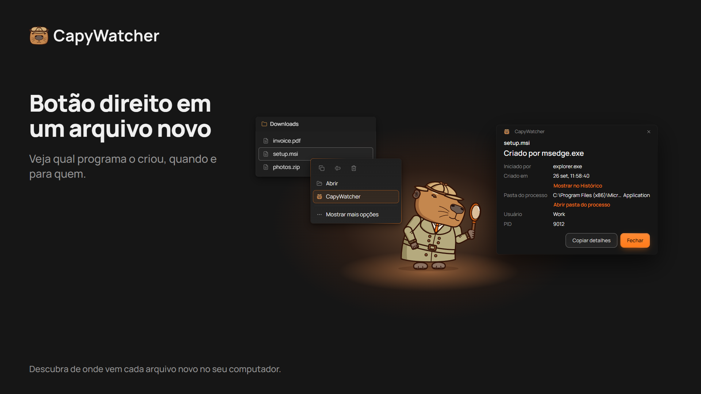
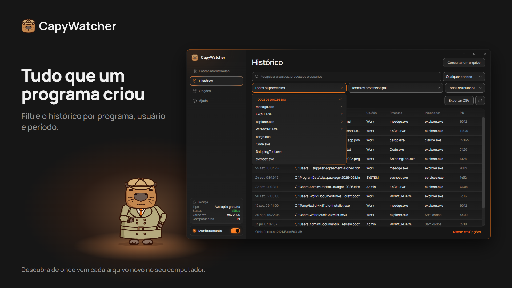

  <picture>
    <source media="(prefers-color-scheme: dark)" srcset="https://raw.githubusercontent.com/capywatcher/capywatcher/main/images/logo-dark.png">
    <source media="(prefers-color-scheme: light)" srcset="https://raw.githubusercontent.com/capywatcher/capywatcher/main/images/logo-light.png">
    
  </picture>

  <h1>CapyWatcher: quem criou este arquivo?</h1>

  
<strong>Clique com o botão direito em um arquivo novo no Windows e veja qual programa o criou, e qual agente de IA iniciou esse programa.</strong>

  
<a href="https://capywatcher.com/pt/download">Baixar a avaliação gratuita</a> &nbsp;·&nbsp; <a href="https://capywatcher.com/pt/pricing">Ver preços</a> &nbsp;·&nbsp; <a href="https://capywatcher.com/pt/release-notes">Ler as notas da versão</a>

  
Windows 11, ou Windows 10 versão 1803 ou mais recente, 64 bits (x64). Grátis por 7 dias, sem cartão e sem e-mail.

  

    
    &nbsp;
    
    &nbsp;
    
  

  
<a href="README.md">English</a> &nbsp;·&nbsp; <a href="README.de.md">Deutsch</a> &nbsp;·&nbsp; <a href="README.es.md">Español</a> &nbsp;·&nbsp; <a href="README.fr.md">Français</a> &nbsp;·&nbsp; <a href="README.it.md">Italiano</a> &nbsp;·&nbsp; <a href="README.pl.md">Polski</a> &nbsp;·&nbsp; Português (Brasil) &nbsp;·&nbsp; <a href="README.ja.md">日本語</a>

## Para que serve

O Windows não guarda qual programa criou um arquivo, e a maioria das ferramentas só vê o que acontece enquanto você está olhando. O CapyWatcher roda em segundo plano e registra cada arquivo novo nas pastas que você escolher: o programa que o criou, o programa que iniciou esse, o usuário e a hora. Quando um arquivo aparece e você se pergunta de onde ele veio, a resposta já está lá.

Feito para quem usa agentes de IA de programação como Claude Code, Codex ou Cursor, para usuários avançados do Windows com arquivos misteriosos, e para quem quer saber qual instalador, jogo, download ou script colocou um arquivo no computador.

## Recursos

### A resposta no botão direito

Clique com o botão direito em um arquivo no Explorador de Arquivos (no Windows 11, em Mostrar mais opções) e selecione CapyWatcher. Uma janela pequena mostra qual programa o criou, quando, para qual usuário, e a cadeia de programas que o iniciou. Você também pode consultar um arquivo pelo app, ou soltar arquivos e pastas na janela dele.

### O histórico por programa

Comece por um programa e veja cada arquivo que ele criou. Pesquise caminhos, programas e usuários, e filtre por programa, processo pai, usuário e período, com uma contagem ao lado de cada um. Oculte um processo que cria arquivos o dia todo (com Desfazer) e salve as linhas filtradas em um arquivo CSV.

### O que o seu agente de IA escreveu

Um arquivo escrito por `cargo.exe` ou `node.exe` também mostra o programa que o iniciou, por exemplo `claude.exe`. Assim você vê o que o seu agente de IA escreveu, e onde. Como o `git blame`, para arquivos novos.

### Vários arquivos e renomeações

Selecione vários arquivos, clique com o botão direito e veja o programa de cada um. Um download renomeado no fim ainda mostra o navegador que o salvou.

### Só as pastas que você escolher

Escolha as pastas para monitorar, em qualquer unidade do seu computador. Uma unidade desconectada mantém a configuração até voltar.

### Bloqueios e alertas de exclusão

Cada pasta monitorada tem o próprio cadeado e o próprio sino, e você pode usar um dos dois ou ambos. Bloqueie uma pasta monitorada, e nada poderá excluir, mover ou renomear os arquivos dela até você desbloqueá-la. Um programa executado como administrador pode remover o bloqueio. Ative o sino de uma pasta monitorada, e uma notificação do Windows diz qual programa excluiu arquivos e quantos, com um botão para pará-lo.

### Um histórico sob controle

Escolha por quanto tempo o histórico fica guardado, quanto ele pode crescer, o que acontece no limite e em qual pasta ele é salvo. Apague tudo quando quiser.

### Discreto, ao lado do relógio

O app inicia com o Windows na bandeja, ao lado do relógio. As notificações do Windows avisam quando há uma atualização pronta e quando o histórico está quase cheio, e as novas versões podem se instalar sozinhas.

### Do seu jeito

Temas claro e escuro, e alto contraste do Windows. Todas as telas funcionam só com o teclado e com um leitor de tela, e seguem a configuração Tamanho do texto do Windows até 225 %. Salve suas configurações em um arquivo e carregue-as em outro computador.

### Leve para o seu computador

O serviço em segundo plano usa menos de 20 MB de memória e menos de 1 % da CPU enquanto registra arquivos novos.

### Em 8 idiomas

Inglês, alemão, espanhol, francês, italiano, polonês, português (Brasil) e japonês. O app usa o idioma do seu Windows quando tem esse idioma.

## Privacidade

O histórico fica no seu computador, e o serviço que monitora suas pastas não tem acesso à rede. Sem conta e sem estatísticas de uso. Duas verificações usam a internet, com o servidor do app: a verificação da licença e a busca por atualizações. Elas nunca enviam seus arquivos, seu histórico ou o nome do seu computador.

[Ler a política de privacidade](https://capywatcher.com/pt/privacy)

## Os limites, com honestidade

- Ele registra arquivos novos a partir da instalação, então não sabe nada sobre os anteriores.
- O Histórico registra arquivos criados ou renomeados nas pastas monitoradas, não exclusões nem edições.
- Não funciona em unidades de rede, só nas unidades do seu computador.
- Ele registra qual programa criou um arquivo. Uma pasta bloqueada recusa exclusões, movimentações e mudanças de nome, não arquivos novos.

## Preço

Teste todos os recursos grátis por 7 dias, sem cartão e sem e-mail. Depois, US$ 29 por ano até você cancelar, ou US$ 49 uma vez. Cada licença vale para até 3 computadores.

Os preços estão em dólares americanos. Impostos podem ser somados no pagamento, conforme o lugar onde você mora.

[Ver preços](https://capywatcher.com/pt/pricing)

## Sobre este repositório

O CapyWatcher tem código fechado, então este repositório guarda a página do produto, não o código. Baixe o app em [capywatcher.com](https://capywatcher.com/pt/download).

## Ajuda e novidades

- E-mail: [support@capywatcher.com](mailto:support@capywatcher.com)
- X: [@CapyWatcherApp](https://x.com/CapyWatcherApp), para novidades e mensagens diretas
- Notas da versão: [capywatcher.com/pt/release-notes](https://capywatcher.com/pt/release-notes), com um [feed RSS](https://capywatcher.com/pt/release-notes/rss.xml)

## Feito por Admiral Capy

[Seguir @AdmiralCapy no X](https://x.com/AdmiralCapy) · [Ler sobre o criador](https://capywatcher.com/pt/about)
