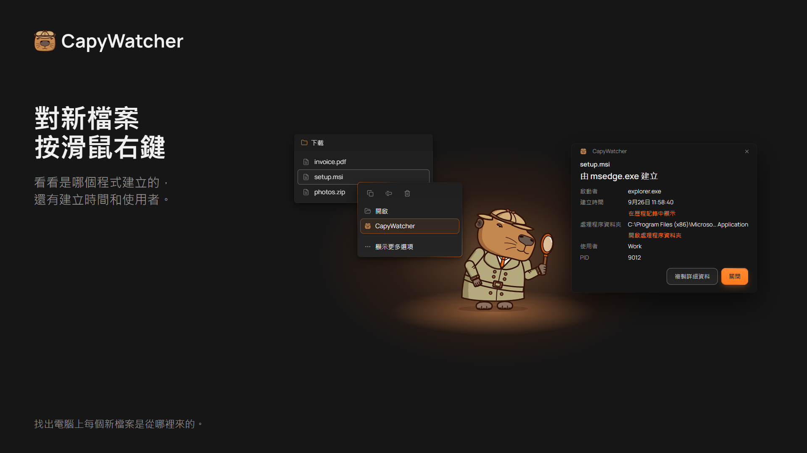
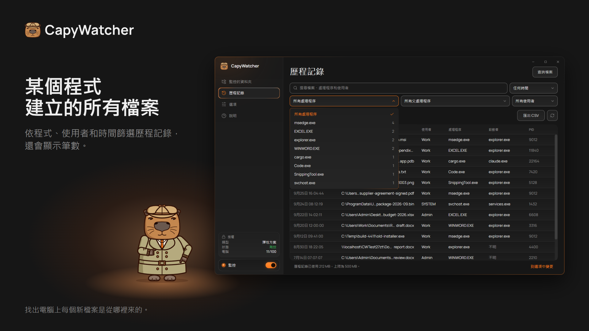

  <picture>
    <source media="(prefers-color-scheme: dark)" srcset="https://raw.githubusercontent.com/capywatcher/capywatcher/main/images/logo-dark.png">
    <source media="(prefers-color-scheme: light)" srcset="https://raw.githubusercontent.com/capywatcher/capywatcher/main/images/logo-light.png">
    
  </picture>

  <h1>CapyWatcher：這個檔案是哪個程式建立的？</h1>

  
<strong>在 Windows 中對新檔案按滑鼠右鍵，就能看到是哪個程式建立了它，以及是哪個 AI 代理啟動了那個程式。</strong>

  
<a href="https://capywatcher.com/zh-tw/download">下載免費試用版</a> &nbsp;·&nbsp; <a href="https://capywatcher.com/zh-tw/pricing">查看價格</a> &nbsp;·&nbsp; <a href="https://capywatcher.com/zh-tw/release-notes">閱讀版本資訊</a>

  
Windows 11，或 Windows 10 版本 1803 以上，64 位元 (x64)。可免費試用 7 天，不需信用卡，也不需電子郵件。

  
最新版本：<strong>1.1.7</strong>，2026年11月12日發布。

  

    
    &nbsp;
    
    &nbsp;
    
  

  
<a href="README.md">English</a> &nbsp;·&nbsp; <a href="README.de.md">Deutsch</a> &nbsp;·&nbsp; <a href="README.es.md">Español</a> &nbsp;·&nbsp; <a href="README.fr.md">Français</a> &nbsp;·&nbsp; <a href="README.it.md">Italiano</a> &nbsp;·&nbsp; <a href="README.pl.md">Polski</a> &nbsp;·&nbsp; <a href="README.pt-BR.md">Português (Brasil)</a> &nbsp;·&nbsp; <a href="README.ja.md">日本語</a> &nbsp;·&nbsp; 繁體中文

## 它能幫您做什麼

Windows 不會記錄檔案是哪個程式建立的，大多數工具也只看得到您開著它們時發生的事。CapyWatcher 在背景執行，記錄您選擇的資料夾中出現的每個新檔案：建立它的程式、啟動那個程式的程式、使用者和時間。等到陌生的檔案冒出來，想知道它從哪裡來時，答案早就記好了。

它適合用 Claude Code、Codex、Cursor 等 AI 代理寫程式的人，常被來路不明的檔案困擾的 Windows 進階使用者，以及任何想知道是哪個安裝程式、遊戲、下載或指令碼把檔案放進電腦的人。

## 功能

### 按滑鼠右鍵，就有答案

在檔案總管中對檔案按滑鼠右鍵 (Windows 11 在 [顯示更多選項] 底下)，選取 [CapyWatcher: 這個檔案是誰建立的?]。小視窗會顯示建立它的程式、日期和時間、使用者，以及一層層啟動它的程式。也可以在應用程式中查詢檔案，或把檔案或資料夾拖放到視窗上。

### 檔案總管的子選單

在檔案、資料夾或磁碟機上按滑鼠右鍵 (USB 隨身碟和網路磁碟機也可以)，就能開啟 CapyWatcher 子選單：在歷程記錄中顯示、開始或停止監控、鎖定或解除鎖定資料夾，以及開啟或關閉刪除通知。

### 哪個程式在使用這個檔案

在檔案或資料夾上按滑鼠右鍵，就會列出正在使用它的每個程式，包括圖示、名稱和使用者。您可以在同一個視窗中關閉程式；如果關不掉，就停止它。在資料夾中，應用程式會檢查前 5,000 個檔案。

### 依程式查看歷程記錄

從一個程式出發，就能查看它建立的每個檔案。您可以搜尋檔案路徑、程式和使用者，也能依程式、父處理程序、使用者和時間範圍篩選，每個選項旁都會顯示筆數。整天都在建立檔案的處理程序可以隱藏 (也能 [復原])，篩選出來的資料列可以儲存為 CSV 檔案。

### 您的 AI 代理寫了什麼

由 `cargo.exe` 或 `node.exe` 寫入的檔案，也會顯示啟動它們的程式，例如 `claude.exe`。這樣就能看到 AI 代理寫了什麼、寫在哪裡，就像新檔案專用的 `git blame`。

### 一次多個檔案，改名後也查得到

選取多個檔案後按滑鼠右鍵，就能看到每個檔案是哪個程式建立的。下載完成時被改名的檔案，仍會顯示是哪個瀏覽器儲存的。

### 只監控您選擇的資料夾

要監控的資料夾由您選擇，可以在電腦的任何磁碟機、USB 隨身碟上，或在您新增的網路磁碟機或共用資料夾上。磁碟機沒有連接時，設定會保留到它重新連接。[監控的資料夾] 也會顯示每個資料夾建立和刪除了多少檔案：今天、過去 7 天、過去 30 天，或開始監控以來。

### 資料夾鎖定和刪除通知

每個監控的資料夾都可以鎖定、開啟刪除通知，或兩者都用。資料夾鎖定後，在您解除鎖定之前，任何程式都無法刪除、移動或重新命名其中的檔案。以系統管理員身分執行的程式可以移除鎖定，CapyWatcher 會在 2 秒內重新鎖上，並通知您。開啟刪除通知後，Windows 通知會告訴您是哪個程式刪除了檔案、刪除了多少，並附上停止它的按鈕。

### 歷程記錄由您掌控

歷程記錄保留多久、最多占用多少空間、達到上限時怎麼處理，以及存放在哪個資料夾，都由您決定。您也隨時可以全部刪除。

### 在時鐘旁安靜執行

應用程式隨 Windows 啟動，在時鐘旁的系統匣中執行。有更新可以安裝，或歷程記錄快滿時，它會發出 Windows 通知，新版本也能自動安裝。

### 配合您的使用方式

支援淺色和深色主題，以及 Windows 的對比佈景主題。每個檢視都能只用鍵盤操作，也支援螢幕助讀程式，並會跟隨 Windows 的 [文字大小] 設定，最大到 225%。設定可以儲存到檔案，再於另一台電腦上載入。

### 不占電腦資源

背景服務約使用 8 MB 記憶體。應用程式隱藏在系統匣時約使用 4 MB，幾乎不占 CPU；最小化時約 23 MB，開啟視窗時 50 到 90 MB。服務閒置時的 CPU 使用率接近 0%，即使每秒寫入數千個檔案，也只有約 1%。在 12 核心的 Windows 11 上，以工作管理員測得。

### 支援 9 種語言

英文、德文、西班牙文、法文、義大利文、波蘭文、葡萄牙文 (巴西)、日文和繁體中文。如果應用程式有您的 Windows 顯示語言，就會使用它。

## 隱私權

歷程記錄留在您的電腦上，監控資料夾的服務無法連上網路。歷程記錄經過加密，其他程式無法讀取，複製到其他電腦也打不開，即使那台電腦有 CapyWatcher 和有效的授權也一樣。沒有帳號，也沒有使用統計。只有兩項檢查會連到應用程式自己的伺服器：授權檢查和更新檢查。兩者都不會傳送您的檔案、歷程記錄或電腦名稱。

[閱讀隱私權政策](https://capywatcher.com/zh-tw/privacy)

## 老實說，它做不到這些

- 它從安裝的那一刻起記錄新的檔案，所以無法告訴您安裝之前就存在的檔案。
- [歷程記錄] 記錄的是監控的資料夾中建立或改名的檔案，不記錄刪除或修改。
- 在網路磁碟機或共用資料夾上，它只記錄您電腦上的程式在那裡做了什麼。
- 它記錄的是哪個程式建立了檔案。鎖定的資料夾會拒絕刪除、移動和重新命名，但不會擋下新檔案。

## 價格

先免費試用 7 天，可使用所有功能，不需信用卡，也不需電子郵件。之後一次付清：US$49 的永久授權最多可用於 3 台電腦，或選擇每台電腦 US$13.30 起的彈性方案。要安裝到很多台電腦時，可以照[下載頁面](https://capywatcher.com/zh-tw/download#it)的說明，在安裝指令中帶入授權金鑰，每台電腦就會自行啟用金鑰。

價格以美元計。結帳時可能會依您所在的地區加收稅金。

[查看價格](https://capywatcher.com/zh-tw/pricing)

## 關於這個存放庫

CapyWatcher 不公開原始碼，所以這個存放庫放的是它的產品介紹，不是程式碼。請到 [capywatcher.com](https://capywatcher.com/zh-tw/download) 下載應用程式。

保留所有權利。您可以用這個應用程式做什麼，寫在[使用條款](https://capywatcher.com/zh-tw/terms#ip)中。

## 支援和最新消息

- 電子郵件：[support@capywatcher.com](mailto:support@capywatcher.com)
- X：[@CapyWatcherApp](https://x.com/CapyWatcherApp) (最新消息和私訊)
- 版本資訊：[capywatcher.com/zh-tw/release-notes](https://capywatcher.com/zh-tw/release-notes) (也可以[用 RSS 訂閱](https://capywatcher.com/zh-tw/release-notes/rss.xml))
- 部落格：[capywatcher.com/zh-tw/blog](https://capywatcher.com/zh-tw/blog) (也可以[用 RSS 訂閱](https://capywatcher.com/zh-tw/blog/rss.xml))

## 由 Admiral Capy 開發

[在 X 上追蹤 @AdmiralCapy](https://x.com/AdmiralCapy) · [關於開發者](https://capywatcher.com/zh-tw/about)
